# Parts-to-Pallet trên humanoid 2 tay YellowArm — báo cáo kết quả (G6)

Denso Hackathon 2026. Báo cáo cập nhật 2026-10-11. Mọi bảng số trong mục "Bảng kết quả" do `scripts/make_report.py`
sinh ra từ `results/*.json` (chạy lại script là cập nhật được). Bảng chi tiết hơn và CSV nằm ở `results/summary_tables.md`,
`results/summary.csv` (mỗi dòng là một ô eval) và `results/summary_train.csv`.

## Tóm tắt

- **Cả hai model đã eval đều còn xa ngưỡng lắp robot thật.** Trên seed test, L1 in-dist: ACT 14/50 (28%, Wilson 95%
  [17%, 42%]), SmolVLA 12/50 (24%, [14%, 37%]). L2 (chọn đúng vật theo câu lệnh): SmolVLA 3/50 (6%, [2%, 16%]). Ngưỡng
  đề xuất ở G7 là ≥ 80% L1 và ≥ 60% L2. Expert lập trình sẵn đạt 49/50 (L1) và 47/50 (L2) trong cùng điều kiện có
  domain randomization, nên tác vụ làm được: phần thiếu nằm ở policy.
- **Ở L1, ACT và SmolVLA ngang nhau.** Khoảng tin cậy chồng lên nhau ở mọi split. ACT infer nhanh hơn khoảng 12 lần
  (khoảng 29 ms so với khoảng 358 ms) và train từ đầu trong khoảng 2.3 h.
- **Vật màu/hình chưa thấy ít ảnh hưởng, vị trí mới thì hỏng hoàn toàn.** Đổi màu hay hình vật đích (heldout) không làm tụt
  rõ rệt: ACT gần như giữ nguyên, SmolVLA tụt nhẹ nhưng nằm trong sai số. Vật đặt ngoài vùng train (`wide`, vành ≤ 10 cm)
  thì **0/50 với cả hai model, ở cả L1 và L2**: không lần nào nhấc được vật.
- **Ba nút cổ chai chính.** (1) Không nhấc được vật: 20–35/50 episode ở mọi ô ngoài `wide`. (2) Khâu đặt: trong số episode nhấc được
  vật, chỉ khoảng một nửa đặt đạt. (3) Ở L2, SmolVLA chưa bám câu lệnh: 6–10/50 episode đặt nhầm vật nhiễu lên pallet (ngoài `wide`),
  chỉ 9–15/50 nhấc đúng vật đích.
- **GR00T N1.7 đã train nhưng chưa eval.** Kiểm tra offline cho thấy fit kém và đã tìm ra hai lỗi cấu hình (task 4.7,
  đang tạm dừng). π0.5 không train được trên GPU 16 GB (khoảng 22 h cho 20k step), đã dừng.

## Thiết lập thí nghiệm

**Robot (sim).** Humanoid nửa thân trên gồm 2 cánh tay YellowArm 7 khớp + gripper và camera đầu cố định. Cấu hình
`forward45`: mặt gắn tay cao 0.45 m, hai vai cách nhau 0.55 m, khe thân–bàn 0.05 m. Thông số trong
`scripts/data/humanoid.json`. Giới hạn khớp, tốc độ và lực lấy đúng theo URDF, không nới. Isaac Sim 6.0.1, physics
100 Hz, điều khiển 25 Hz.
**Quan sát / hành động.** State 16 và action 16 (mỗi tay 7 khớp + gripper 0..1). 3 camera RGB 256×256: đầu, cổ tay trái,
cổ tay phải.

**Tác vụ.** Gắp vật đặt vào một ô trống của pallet 2×3. Thành công khi vật đích nằm trong ô vốn trống, nằm thấp,
đứng yên, không lật quá 30°, và (ở L2) không có vật nào khác trên pallet. Pallet có sẵn 0–3 vật.
- **L1:** trên bàn có 1 vật. Câu lệnh "put the {color} {shape} on the pallet".
- **L2:** trên bàn có 3–4 vật, câu lệnh chỉ định 1 vật.
- **Split:** `train` (in-dist); `heldout_color` (vật đích màu purple, chưa có trong dữ liệu); `heldout_shape` (vật
  đích hình đai ốc lục giác, chưa có trong dữ liệu); `wide` (tâm vật đích nằm ngoài vùng đặt vật lúc train, trong vành
  ≤ 10 cm quanh vùng đó).
- **Domain randomization** bật ở cả lúc sinh dữ liệu lẫn lúc eval: ánh sáng, màu/texture mặt bàn, camera đầu lệch ±2 cm
  / ±3°, ma sát vật 0.7–1.2, khối lượng vật ×0.8–1.25.

**Dữ liệu.** `datasets/lerobot/yellowarm_pallet_all`: 600 episode expert thành công (L1 300 + L2 300; mỗi mức gồm 200
sạch + 100 có nhiễu DART 0.02/0.03), 179 127 frame, trung vị 11.9 s/episode. Lệch tay: trái 222 / phải 378. Màu train:
red, green, blue, yellow, orange. Hình train: box, flat_box, cyl_up, cyl_lying. Ô đích chỉ có 0/2/3/5, vì giới hạn khớp 1
khiến cột giữa không với tới được (xem việc còn mở ở 7.1 trong PLAN.md).

**Model.**
| Model | Khởi tạo | Cấu hình train | Eval |
|---|---|---|---|
| ACT | từ đầu (mặc định lerobot) | 100k step, batch 8 | có |
| SmolVLA | `models/smolvla_base_humanoid` (smolvla_base đổi sang 16-D) | 40k step, batch 8, train như các lần trước | có |
| GR00T N1.7 | `nvidia/GR00T-N1.7-3B` | 20k step, batch 8, LLM + vision + DiT đóng băng, bf16 (529M tham số train) | **chưa** |
| π0.5 | `lerobot/pi05_base` | smoke 200 step, dừng ở khoảng 130 step | không |

**Giao thức eval** (`scripts/eval_harness.py`, `humanoid_pallet_sim.py --port`):
- 50 episode mỗi ô, seed test 100000–100049. Cùng seed thì cùng bố cục, cùng DR, cùng model và cùng điều kiện.
- `--episode-seconds` = 2 × trung vị expert (L1 23.76 s, L2 23.84 s).
- Bật bộ chống rung `--smooth`: crossfade 8 bước ở chỗ nối chunk + giới hạn vận tốc/gia tốc khớp. Không cần train lại.
- `exec-steps` chọn riêng cho từng model trên seed validation 200000–200019 (L1 in-dist, 20 episode, thử
  {4, 8, 16, 32}). Kết quả: cả hai model đều chọn 16. Không có lựa chọn nào dựa trên seed test.
- Policy lấy mẫu ngẫu nhiên (flow-matching / VAE) và vật lý không tất định, nên cùng seed chỉ cố định bố cục, không cố
  định kết quả.

## Bảng kết quả




<!-- BEGIN:tables -->
<!-- sinh tự động bởi scripts/make_report.py — không sửa tay -->
### Bảng 1 — Tỉ lệ thành công (seed test, Wilson 95%)

| model | exec | chunk | L1 in-dist | L1 heldout màu | L1 heldout hình | L1 wide | L2 in-dist | L2 heldout màu | L2 heldout hình | L2 wide |
|---|---|---|---|---|---|---|---|---|---|---|
| ACT | 16 | 100 | 14/50 (28%) [0.17, 0.42] | 13/50 (26%) [0.16, 0.40] | 14/50 (28%) [0.17, 0.42] | 0/50 (0%) [0.00, 0.07] | N/A | N/A | N/A | N/A |
| SmolVLA | 16 | 50 | 12/50 (24%) [0.14, 0.37] | 7/50 (14%) [0.07, 0.26] | 9/50 (18%) [0.10, 0.31] | 0/50 (0%) [0.00, 0.07] | 3/50 (6%) [0.02, 0.16] | 6/50 (12%) [0.06, 0.24] | 5/50 (10%) [0.04, 0.21] | 0/50 (0%) [0.00, 0.07] |

Seed: 100000–100049; episode-seconds: L1 23.76 s, L2 23.84 s; chống rung (`--smooth`): có; mọi ô hoàn tất: có.
N/A = không chạy (ACT không nhận câu lệnh nên không có L2).

### Bảng 2 — Tổng quát hoá: tỉ lệ split / tỉ lệ in-dist cùng mức

| model | mức | in-dist | heldout màu | heldout hình | wide |
|---|---|---|---|---|---|
| ACT | L1 | 28% | 26% (×0.93) | 28% (×1.00) | 0% (×0.00) |
| SmolVLA | L1 | 24% | 14% (×0.58) | 18% (×0.75) | 0% (×0.00) |
| SmolVLA | L2 | 6% | 12% (×2.00) | 10% (×1.67) | 0% (×0.00) |

Tỉ số tính trên điểm ước lượng; với k nhỏ (≤ 15/50) khoảng tin cậy của tỉ số rất rộng — đọc kèm Bảng 1.

### Bảng 3 — Phân loại kết cục (mỗi episode đúng 1 loại)

| model | mức | split | thành công | vật nhiễu lên pallet | không nhấc được vật đích | nhấc nhưng không vào ô | vào ô nhưng đặt hỏng | nhấc được vật đích | thành công tay trái | tay phải |
|---|---|---|---|---|---|---|---|---|---|---|
| ACT | L1 | in-dist | 14 | 0 | 20 | 6 | 10 | 30/50 | 3/18 | 11/32 |
| ACT | L1 | heldout màu | 13 | 0 | 17 | 4 | 16 | 33/50 | 5/14 | 8/36 |
| ACT | L1 | heldout hình | 14 | 0 | 27 | 5 | 4 | 23/50 | 3/18 | 11/32 |
| ACT | L1 | wide | 0 | 0 | 50 | 0 | 0 | 0/50 | 0/29 | 0/21 |
| SmolVLA | L1 | in-dist | 12 | 0 | 21 | 9 | 8 | 29/50 | 5/18 | 7/32 |
| SmolVLA | L1 | heldout màu | 7 | 0 | 25 | 5 | 13 | 25/50 | 3/14 | 4/36 |
| SmolVLA | L1 | heldout hình | 9 | 0 | 27 | 4 | 10 | 23/50 | 3/18 | 6/32 |
| SmolVLA | L1 | wide | 0 | 0 | 50 | 0 | 0 | 0/50 | 0/29 | 0/21 |
| SmolVLA | L2 | in-dist | 3 | 10 | 29 | 2 | 6 | 11/50 | 0/18 | 3/32 |
| SmolVLA | L2 | heldout màu | 6 | 9 | 28 | 1 | 6 | 15/50 | 1/16 | 5/34 |
| SmolVLA | L2 | heldout hình | 5 | 6 | 35 | 2 | 2 | 9/50 | 0/14 | 5/36 |
| SmolVLA | L2 | wide | 0 | 3 | 47 | 0 | 0 | 0/50 | 0/24 | 0/26 |

Thứ tự xét: thành công → có vật khác trên pallet → không nhấc vật đích (> 3 cm) → chưa từng vào ô → còn lại (vào ô nhưng nghiêng/chưa yên/ô đã có vật/không còn trong ô lúc kết thúc).

### Bảng 4 — Chi phí và độ trễ

| run | model | khởi tạo | step | batch | giờ train | step/s | VRAM train (log, GB) | loss đầu → cuối | ghi chú |
|---|---|---|---|---|---|---|---|---|---|
| act_pallet_all | ACT | scratch (lerobot defaults) | 100000 | 8 | 2.29 | 12.11 | 1.60 | 0.109 → 0.0454 | 2 đoạn: 0–20345 (0.47 h) + resume (1.82 h) |
| smolvla_pallet_all | SmolVLA | models/smolvla_base_humanoid | 40000 | 8 | 2.43 | 4.56 | 3.57 | 2.516 → 0.0272 |  |
| groot_pallet_all | GR00T N1.7 | nvidia/GR00T-N1.7-3B (LLM + vision + DiT frozen, bf16) | 20000 | 8 | 2.38 | 2.33 | 12.73 | 1.276 → 0.027 |  |
| pi05_pallet_all_smoke | π0.5 | lerobot/pi05_base (expert-only fine-tune) | 200 | 8 | 0.03 | 2.25 | – | – | không hoàn tất (exit 1) |

| model | exec | ngân sách exec/25 Hz | infer server TB (ms) | infer phía sim TB (ms) | infer phía sim max (ms) | đạt ngân sách (TB) | VRAM infer đỉnh (GiB) |
|---|---|---|---|---|---|---|---|
| ACT | 16 | 640 ms | 26 | 29 | 318 | có | 0.22 |
| SmolVLA | 16 | 640 ms | 355 | 358 | 1297 | có (max vượt) | 0.91 |

Độ trễ là trung bình có trọng số theo episode trên mọi ô của Bảng 1; đo khi 2 worker eval dùng chung GPU (RTX 4070 Ti SUPER) nên cao hơn lúc GPU rảnh. VRAM train là số `mem` lerobot in ra trong log, không phải đỉnh `nvidia-smi`.

### Bảng 5 — Chọn exec-steps (seed validation, L1 in-dist, 20 ep)

| run | exec 4 | exec 8 | exec 16 | exec 32 | chọn |
|---|---|---|---|---|---|
| act_pallet_all | 2/20 | 4/20 | 6/20 | 7/20 | 32 |
| act_pallet_all_smooth (--smooth) | 3/20 | 6/20 | 9/20 | 7/20 | 16 |
| smolvla_pallet_all_smooth (--smooth) | 2/20 | 1/20 | 3/20 | 1/20 | 16 |

Run không có `--smooth` chỉ để tham khảo (5.2 tương ứng đã dừng giữa chừng, không có kết quả).

### Bảng 6 — Expert lập trình sẵn (tham chiếu trần, KHÔNG cùng bộ seed với Bảng 1)

| file | mức | split | DR | seed | thành công |
|---|---|---|---|---|---|
| expert_L1_20_heldout_shape | L1 | heldout_shape | có | 100000–100019 | 19/20 [0.76, 0.99] |
| expert_L1_20_wide | L1 | wide | có | 100000–100019 | 20/20 [0.84, 1.00] |
| expert_L1_50 | L1 | train | không | 0–49 | 50/50 [0.93, 1.00] |
| expert_L1_50_dr | L1 | train | có | 0–49 | 49/50 [0.90, 1.00] |
| expert_L2_20_heldout_color | L2 | heldout_color | có | 100000–100019 | 20/20 [0.84, 1.00] |
| expert_L2_20_wide | L2 | wide | có | 100000–100019 | 20/20 [0.84, 1.00] |
| expert_L2_50 | L2 | train | không | 0–49 | 49/50 [0.90, 1.00] |
| expert_L2_50_dr | L2 | train | có | 0–49 | 47/50 [0.84, 0.98] |

Dataset `_all`: 600 episode, 179127 frame; tay trái/phải 222/378.

### Bảng 7 — Ngưỡng G7 (đề xuất trong PLAN.md)

| model | L1 in-dist ≥ 80% | L2 in-dist ≥ 60% | wide ≥ ½ in-dist (L1) | infer TB ≤ ngân sách |
|---|---|---|---|---|
| ACT | không (28%) | N/A | không (0% vs 28%) | ĐẠT (29 ≤ 640 ms) |
| SmolVLA | không (24%) | không (6%) | không (0% vs 24%) | ĐẠT (358 ≤ 640 ms) |
<!-- END:tables -->

## Phân tích

**ACT so với SmolVLA (L1).**
- Không phân định được thắng thua: chênh lệch 2–6 episode/50 nằm gọn trong khoảng tin cậy.
- ACT có lợi thế rõ về chi phí: infer khoảng 29 ms (ngân sách ở exec 16 / 25 Hz là 640 ms), VRAM infer 0.2 GiB, train
  1.6 GB.
- SmolVLA đạt ngân sách khi tính trung bình (khoảng 358 ms). Tuy nhiên một số lần infer lẻ vượt 640 ms (max khoảng
  1.3 s, đo khi 2 worker dùng chung GPU), nên trên phần cứng yếu hơn (Jetson) robot sẽ bị khựng.
- SmolVLA là model duy nhất làm được L2, vì ACT không nhận câu lệnh.

**Tổng quát hoá.**
- Màu và hình chưa thấy gần như không làm tụt tỉ lệ ở ACT: tỉ số ×0.93 và ×1.00 so với in-dist.
- SmolVLA tụt nhiều hơn ở L1 (×0.58 và ×0.75), nhưng vẫn trong sai số.
- Với SmolVLA L2, tỉ lệ heldout cao hơn in-dist (6/50 so với 3/50). Đây là nhiễu do mẫu nhỏ, không phải hiệu ứng thật.
  Một giả thuyết hợp lý là vật đích màu/hình lạ dễ phân biệt với vật nhiễu, nhưng chưa kiểm chứng.
- Split `wide` 0/50 ở mọi ô cho thấy policy học thuộc vùng không gian của dữ liệu. Đây là hạn chế lớn nhất nếu tính
  chuyện mang lên robot thật, nơi vị trí vật khó giữ trong một vùng hẹp. Expert vẫn đạt 20/20 ở `wide`, nên muốn sửa
  chỉ cần thêm dữ liệu phủ rộng hơn.

**Lỗi theo giai đoạn** (Bảng 3).
- Lỗi phổ biến nhất ở mọi model và split là không nhấc được vật đích: kẹp hụt, hoặc không kẹp.
- Episode nhấc được vật vẫn hỏng ở khâu đặt khá nhiều: vật nghiêng hoặc chưa yên, vào ô đã có vật, hoặc không vào ô.
- Tay trái kém hơn tay phải ở mọi ô, khớp với lệch dữ liệu 37/63. Ví dụ ACT L1 in-dist: trái 3/18, phải 11/32.

**Chọn exec-steps.**
- Ở seed validation, ACT tốt nhất ở exec 16 (9/20) khi có `--smooth`, và ở exec 32 khi không có.
- SmolVLA phân biệt kém giữa các mức (1–3/20). Lựa chọn exec 16 vì thế không chắc chắn; 20 episode là quá ít để chọn
  tinh hơn.

**GR00T N1.7.** Model chưa được eval nên không có trong Bảng 1. Kiểm tra offline (12 frame) cho sai số action đầu
chunk 0.042 rad, so với 0.008 của ACT/SmolVLA và 0.018 của mốc "giữ nguyên state". Chẩn đoán ngày 2026-10-10 tìm ra
hai lỗi cấu hình:
1. embodiment id âm thầm bằng 0;
2. quantile q01/q99 trong `meta/stats.json` sai.

Ngoài ra DiT đang bị đóng băng. Cấu hình train vì thế không tương đương ACT/SmolVLA. Kế hoạch sửa nằm ở task 4.7
(chưa làm).

## Hạn chế của thí nghiệm

- **Chỉ là mô phỏng.** Robot chưa tồn tại. Khối lượng khâu lấy từ USD, chưa có số CAD. Gripper, ma sát, độ rơ khớp,
  độ trễ servo/camera và ánh sáng đều đã đơn giản hoá. Kết quả sim chỉ là cận trên lạc quan cho robot thật.
- **Vật thể đơn giản hoá.** 4 hình khối cơ bản (+ đai ốc lục giác cho heldout), 6 màu đơn sắc, cạnh kẹp ≤ 60 mm. Không
  có linh kiện thật, vật trong suốt/phản quang, hay vật chồng lên nhau.
- **Số episode.** 50 episode mỗi ô nên Wilson 95% rộng khoảng ±12 điểm phần trăm quanh 25%. Chỉ phân biệt được chênh lệch
  lớn. exec-steps chọn trên 20 episode. Các tỉ số tổng quát hoá (Bảng 2) rất nhạy với k nhỏ.
- **Một lần train cho mỗi model**, không lặp seed train, nên chưa đo được phương sai giữa các lần train.
- **Không cùng công thức train.** ACT train từ đầu, SmolVLA fine-tune từ base, GR00T chỉ train projector. Số step
  khác nhau (100k / 40k / 20k), chọn theo thông lệ của từng model chứ không cân theo thời gian GPU. Thời gian train của
  ba model đều khoảng 2.3–2.4 h.
- **Độ trễ** đo trên RTX 4070 Ti SUPER khi 2 worker eval dùng chung GPU, chưa đo trên Jetson.
- **Dữ liệu.** Lệch tay 37/63. Câu lệnh không nói ô đích. Cột giữa pallet không bao giờ là ô đích. Expert gần như tất
  định nên dữ liệu ít đa dạng về cách gắp. State gần như bằng lệnh khớp ở bước trước (lệch 0–3 mrad), cần xem lại khi so
  với robot thật.
- **Phạm vi bị cắt** (hạn 10/10): chỉ L1/L2 (bỏ L3 gắp nhiều vật và L4 hai tay phối hợp); không có Diffusion Policy và π0;
  không có đường cong theo lượng dữ liệu.

## Tái lập

```
env\python.exe scripts\make_report.py          # bảng + CSV + biểu đồ + chèn bảng vào REPORT.md
```
Kết quả gốc của từng ô: `results/<run>_L<level>_<split>.json`, gồm cấu hình, từng episode và độ trễ. Video tiêu biểu:
`logs/videos/g5_{act_L1,smolvla_L1,smolvla_L2}_representative.mp4`.
